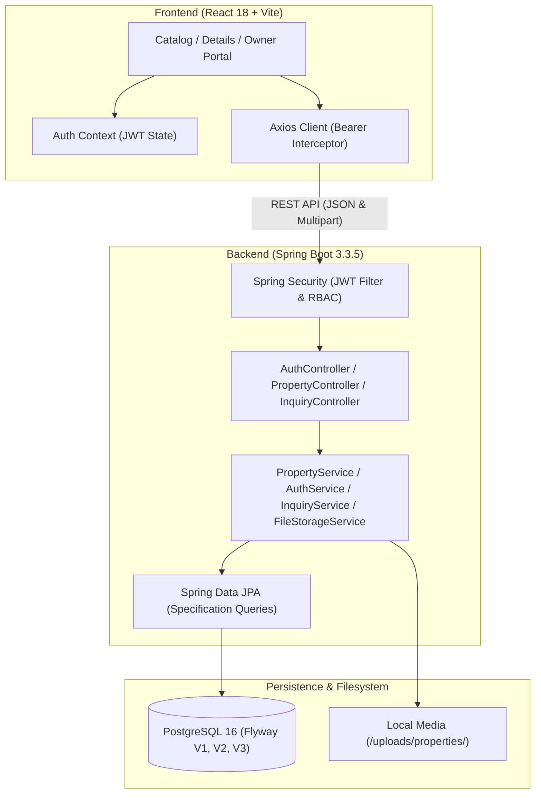

# 🏠 HomeLens - Full-Stack Property & Rental Marketplace

[](https://www.oracle.com/java/)
[](https://spring.io/projects/spring-boot)
[](https://spring.io/projects/spring-security)
[](https://www.postgresql.org/)
[](https://flywaydb.org/)
[](https://react.dev/)
[](https://vitejs.dev/)
[](https://www.docker.com/)

**HomeLens** is a secure, high-performance residential and commercial property marketplace tailored specifically for modern rental dynamics. It bridges property seekers (tenants/buyers) and property owners/agents with transparent financial breakdowns, occupancy rule governance, nearby facility distance metrics, and lead management.

---

## 🌟 Key Features

### 1. Indian Rental Marketplace Domain Priming
- **BHK Configurations:** Native support for `1 RK`, `1 BHK`, `2 BHK`, `3 BHK`, `4 BHK`, and `4+ BHK`.
- **Transparent Price Breakdown:** Base monthly rent in INR (₹) is clearly separated from monthly electricity and water charges, with automatic total monthly charge calculation.
- **Water Availability:** Direct indicator and filter for guaranteed continuous water supply.
- **Occupancy Policies:** Explicit settings for Family Occupancy, Single/Bachelor Occupancy, or both.
- **Property Types:** Gated Community (with amenities/security) vs. Individual House.
- **Nearby Facility Distances:** Track approximate distances in kilometres (km) to:
  - 🏥 Hospitals
  - 🚇 Metro Stations
  - 🚌 Bus Stops
  - 🏫 Schools
  - 🎓 Colleges

### 2. Seeker Experience (`/properties`)
- **Multi-Criteria Search Engine:** Filter by city, rent range (min/max), BHK type, property type, occupancy rules, and water availability.
- **Property Details & Photo Gallery:** Multi-image gallery viewer, full address, feature specifications, facility distances, and property owner contact info.
- **Lead Capture & Inquiry Modal:** Submit rental inquiries or tour requests directly to the property owner.

### 3. Property Owner Portal (`/owner/properties`)
- **"My Properties" Dashboard:** Review all listed properties with live counts of attached photographs and active status.
- **One-Click Availability Toggle:** Switch property availability between `● Available` and `● Rented` instantly.
- **Edit Property Modal:** Modify rent, charges, description, occupancy rules, and nearby facility distances with real-time updates.
- **Multi-Photo Manager:** Visual thumbnail grid with primary photograph indicator, individual photo deletion, and high-resolution photo uploads.
- **Inquiry Inbox & Lead Lifecycle:** Review prospective tenant contact details (Name, Email, Phone, Message) and manage lead status (`NEW` -> `CONTACTED` -> `RESOLVED` -> `CLOSED`).

### 4. Security & Architecture
- **Stateless Authentication:** Cryptographically signed HMAC SHA-256 JWT tokens via Spring Security 6 and JJWT.
- **Role-Based Access Control (RBAC):** Distinct permissions for `ROLE_BUYER`, `ROLE_OWNER`, `ROLE_AGENT`, and `ROLE_ADMIN`.
- **Media Management:** Local filesystem storage pipeline (`uploads/properties/`) with static routing.
- **Zero-Warning Persistence:** Flyway versioned migrations (`V1`, `V2`, `V3`) on PostgreSQL 16.

---

## 🏗️ Architecture Blueprint



---

## 🚀 Quick Start Guide

You can run HomeLens in three different ways:

### Option 1: Docker Compose (Recommended - Complete Full Stack)
Run the entire platform (PostgreSQL database, Spring Boot backend, and React frontend) with a single command:

```bash
# Start all services in the background
docker compose up -d --build
```

- **Frontend:** [http://localhost:3000](http://localhost:3000)
- **Backend API:** [http://localhost:8080](http://localhost:8080)
- **Swagger UI:** [http://localhost:8080/swagger-ui.html](http://localhost:8080/swagger-ui.html)
- **PostgreSQL:** Port `5432`

To shut down:
```bash
docker compose down
```

---

### Option 2: Local CLI Development

#### Prerequisites
- **Java:** JDK 17 or higher
- **Node.js:** v18 or higher (v20+ recommended)
- **Docker Desktop** (or a local PostgreSQL instance)

#### Step 1: Start PostgreSQL
```bash
docker compose up -d postgres
```

#### Step 2: Run the Backend
```bash
cd backend
mvn spring-boot:run
```
*(Backend starts at `http://localhost:8080`)*

#### Step 3: Run the Frontend
```bash
cd frontend
npm install
npm run dev
```
*(Frontend starts at `http://localhost:5173`)*

---

### Option 3: Instant Zero-Setup Test (Embedded Database)
To test all APIs and features without starting PostgreSQL or Docker:

```bash
cd backend
mvn spring-boot:run -Dspring-boot.run.profiles=test
```
Open **[http://localhost:8080/swagger-ui.html](http://localhost:8080/swagger-ui.html)** to interactively test authentication, property creation, search filters, and inquiries.

---

## ⚙️ Environment Variables

Copy `.env.example` to `.env` to customize settings:

| Variable | Default Value | Description |
| :--- | :--- | :--- |
| `SERVER_PORT` | `8080` | Backend HTTP port |
| `DB_URL` | `jdbc:postgresql://localhost:5432/homelens` | JDBC Database Connection URL |
| `DB_USERNAME` | `homelens` | Database username |
| `DB_PASSWORD` | `homelens` | Database password |
| `JWT_SECRET` | `404E6352...` | 256-bit secret key for HMAC SHA-256 |
| `JWT_EXPIRATION_MS` | `86400000` (24h) | JWT validity duration in milliseconds |
| `APP_DEFAULT_PASSWORD` | `ChangeMe123!` | Password for default seeded users |
| `VITE_API_URL` | `http://localhost:8080` | Backend endpoint for frontend client |

---

## 🧪 Automated Testing

HomeLens features an automated integration test suite validating user registration, JWT generation, property lifecycle, photo uploads, and inquiry lead tracking.

Run the test suite:
```bash
cd backend
mvn clean test
```

### Verified Test Scenarios:
- ✅ `AuthIntegrationTests`: Registration, duplicate email rejection, login, bad credentials, authorized `/api/auth/me`, and unauthorized rejection.
- ✅ `PropertyIntegrationTests`: 13-step end-to-end lifecycle test (Owner registration, property registration with Indian rental attributes, search/filtering, detail lookup, rent/distance update, status toggle, local photo upload, public inquiry submission, owner inbox review, inquiry status update, non-owner access denial, and inquiry deletion).
- ✅ `RepositoryIntegrationTests` & `HomeLensApplicationTests`.

---

## 📚 Project Documentation

Detailed architecture specifications and documentation are located in the [`docs/`](file:///c:/Users/Nagaraju%20A/Documents/HomeLens/docs) directory:
- [System Architecture Blueprint](file:///c:/Users/Nagaraju%20A/Documents/HomeLens/docs/architecture/system_architecture.md)
- [REST API Specification](file:///c:/Users/Nagaraju%20A/Documents/HomeLens/docs/api/rest_api_specification.md)
- [Database Schema & ERD](file:///c:/Users/Nagaraju%20A/Documents/HomeLens/docs/database/schema_and_erd.md)
- [Requirements Traceability Matrix](file:///c:/Users/Nagaraju%20A/Documents/HomeLens/docs/planning/roadmap_and_traceability.md)

---

## 🗺️ Implementation Roadmap Status

| Phase | Focus Area | Status |
| :---: | :--- | :---: |
| **Phase 1** | Data Modeling & Baseline Schema | **100% Done ✅** |
| **Phase 2** | Security & Auth Engine | **100% Done ✅** |
| **Enhancement** | Indian Rental Marketplace Priming | **100% Done ✅** |
| **Phase 3** | Property Core APIs & Local Media | **100% Done ✅** |
| **Phase 4** | Frontend Marketplace Experience | **100% Done ✅** |
| **Phase 5** | Property Owner Portal & Inquiries | **100% Done ✅** |
| **Phase 6** | DevOps, Documentation & Release | **100% Done ✅** |
