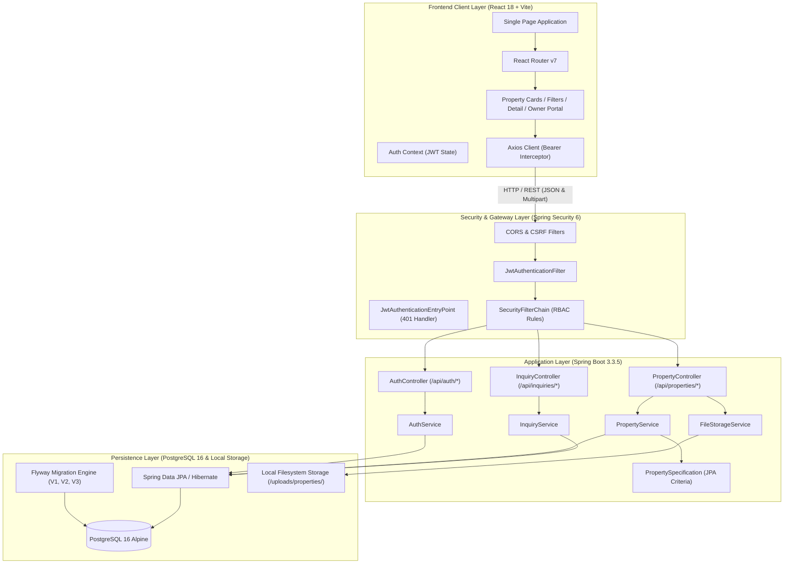

# HomeLens System Architecture Blueprint

## 1. Executive Overview

HomeLens is an enterprise-grade full-stack residential and commercial property marketplace designed specifically for modern rental dynamics. The platform bridges property owners/agents and prospective tenants/buyers with a high-performance, stateless, and reactive experience.

---

## 2. High-Level Architecture Diagram

---

## 3. Core Architectural Layers

### 3.1 Presentation Layer (`/frontend`)
- **Core Framework:** React 18 with modern React hooks (`useState`, `useEffect`, `useContext`, `useParams`, `useNavigate`).
- **Tooling:** Vite powered by `@vitejs/plugin-react-swc` for sub-second hot module replacement.
- **Client Routing:** `react-router-dom` v7 providing client-side declarative routes:
  - `/` — Homepage with Hero search and featured listings.
  - `/properties` — Dynamic rental catalog with live filter drawer.
  - `/properties/:id` — Property inspection, photo carousel, price breakdown, nearby facility distances, and lead capture form.
  - `/owner/properties` — Authenticated Owner Portal (My Properties, Edit Modal, Photo Manager, Inquiry Inbox).
  - `/about` — Platform philosophy and architectural pillars.
- **State & Session Management:** [`AuthContext.jsx`](file:///c:/Users/Nagaraju%20A/Documents/HomeLens/frontend/src/context/AuthContext.jsx) persisting JWT tokens and user profiles in `localStorage`, maintaining reactive authentication state across page reloads.
- **HTTP Client:** Centralized Axios instance with automatic request interceptor attaching `Authorization: Bearer <token>` to protected endpoints.

### 3.2 Security & Authentication Engine (`/backend`)
- **Stateless Architecture:** No server-side HTTP sessions; all authenticated interactions are cryptographically verified using HMAC SHA-256 JWT tokens via JJWT (`0.12.6`).
- **Role-Based Access Control (RBAC):**
  - `ROLE_BUYER` (Property Seeker): Can browse listings, view detailed charges, and submit inquiries.
  - `ROLE_OWNER` (Property Owner): Can register listings, edit their properties, upload/delete photographs, toggle availability status (`AVAILABLE` vs `RENTED`), and manage tenant inquiries.
  - `ROLE_AGENT`: Expanded commercial listing capabilities.
  - `ROLE_ADMIN`: Platform-wide administrative oversight.
- **Password Security:** Salted BCrypt password encoding (`BCryptPasswordEncoder(12)`).
- **Error Handling:** Centralized [`GlobalExceptionHandler.java`](file:///c:/Users/Nagaraju%20A/Documents/HomeLens/backend/src/main/java/com/homelens/exception/GlobalExceptionHandler.java) providing RFC-7807 structured JSON error payloads with status codes (`400 Bad Request`, `401 Unauthorized`, `403 Forbidden`, `404 Not Found`).

### 3.3 Domain & Persistence Layer
- **PostgreSQL 16:** Relational database running on Docker with Flyway version-controlled migrations:
  - `V1__init_schema.sql`: Core relational tables, foreign key constraints, and search indexes.
  - `V2__seed_test_data.sql`: Test users and high-res property data.
  - `V3__enhance_property_requirements.sql`: Indian rental domain priming (BHK types, separate rent/electricity/water charges, water availability flag, family/single occupancy policies, and facility distances in km).
- **Dynamic Search Engine:** [`PropertySpecification.java`](file:///c:/Users/Nagaraju%20A/Documents/HomeLens/backend/src/main/java/com/homelens/repository/PropertySpecification.java) constructing dynamic JPA Criteria Queries combining text search, exact enums, numeric ranges, and boolean filters with pagination and sorting.

### 3.4 Local Media Storage Pipeline
- **Storage Strategy:** Local filesystem directory (`uploads/properties/`) preferred for media assets.
- **Upload Lifecycle:**
  1. Multi-part upload received via `POST /api/properties/{id}/images`.
  2. File verified for allowed MIME types (`image/jpeg`, `image/png`, `image/webp`) and size limits.
  3. Unique UUID-based filename generated to avoid name collisions.
  4. Stored on disk; metadata (relative path, primary flag, order) saved to `property_images` table.
- **Static Asset Serving:** Configured via [`WebMvcConfig.java`](file:///c:/Users/Nagaraju%20A/Documents/HomeLens/backend/src/main/java/com/homelens/config/WebMvcConfig.java), mapping URI pattern `/uploads/**` directly to the local filesystem directory.
