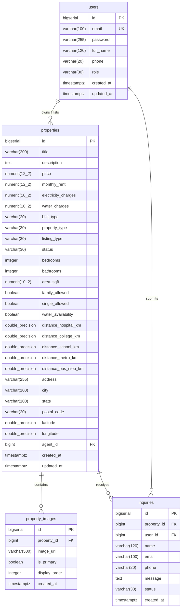

# HomeLens Database Architecture & Entity Relationship Diagram

## 1. Entity Relationship Diagram (ERD)

---

## 2. Flyway Migration Version History

| Migration Version | Description | Key Changes |
| :--- | :--- | :--- |
| `V1__init_schema.sql` | Baseline Schema Creation | Created tables `users`, `properties`, `property_images`, `inquiries` with primary keys, foreign keys with `ON DELETE CASCADE`, and search indexes. |
| `V2__seed_test_data.sql` | Initial Test Data | Seeded default accounts (Admin, Agent, Buyer), 6 realistic multi-city properties, 9 high-res architectural images, and inquiries. |
| `V3__enhance_property_requirements.sql` | Indian Rental Marketplace Priming | Added columns: `monthly_rent`, `electricity_charges`, `water_charges`, `bhk_type`, `water_availability`, `family_allowed`, `single_allowed`, `distance_hospital_km`, `distance_college_km`, `distance_school_km`, `distance_metro_km`, `distance_bus_stop_km`. Backfilled existing test data. |

---

## 3. Data Dictionary

### 3.1 Table: `users`
| Column | Type | Constraints | Description |
| :--- | :--- | :--- | :--- |
| `id` | BIGSERIAL | PRIMARY KEY | Unique user identifier |
| `email` | VARCHAR(100) | NOT NULL, UNIQUE | User email address (login credential) |
| `password` | VARCHAR(255) | NOT NULL | Salted BCrypt password hash |
| `full_name` | VARCHAR(120) | NOT NULL | Full name of user |
| `phone` | VARCHAR(20) | NULL | Contact phone number |
| `role` | VARCHAR(30) | NOT NULL | `ROLE_BUYER`, `ROLE_OWNER`, `ROLE_AGENT`, `ROLE_ADMIN` |
| `created_at` | TIMESTAMPTZ | NOT NULL | Record creation timestamp |
| `updated_at` | TIMESTAMPTZ | NOT NULL | Record last update timestamp |

### 3.2 Table: `properties`
| Column | Type | Constraints | Description |
| :--- | :--- | :--- | :--- |
| `id` | BIGSERIAL | PRIMARY KEY | Unique property identifier |
| `title` | VARCHAR(200) | NOT NULL | Listing title |
| `description` | TEXT | NULL | Detailed property overview |
| `monthly_rent` | NUMERIC(12,2) | NOT NULL | Base monthly rent in INR (₹) |
| `electricity_charges` | NUMERIC(10,2) | DEFAULT 0 | Estimated monthly electricity charges |
| `water_charges` | NUMERIC(10,2) | DEFAULT 0 | Estimated monthly water charges |
| `bhk_type` | VARCHAR(20) | NOT NULL | `1 RK`, `1 BHK`, `2 BHK`, `3 BHK`, `4 BHK`, `4+ BHK` |
| `property_type` | VARCHAR(30) | NOT NULL | `GATED_COMMUNITY` or `INDIVIDUAL_HOUSE` |
| `listing_type` | VARCHAR(30) | NOT NULL | `FOR_RENT` or `FOR_SALE` |
| `status` | VARCHAR(30) | NOT NULL | `AVAILABLE` or `RENTED` |
| `bedrooms` | INTEGER | NOT NULL | Number of bedrooms |
| `bathrooms` | INTEGER | NOT NULL | Number of bathrooms |
| `area_sqft` | NUMERIC(10,2) | NULL | Built-up area in square feet |
| `family_allowed` | BOOLEAN | DEFAULT TRUE | Allows family occupancy |
| `single_allowed` | BOOLEAN | DEFAULT TRUE | Allows bachelor/single occupancy |
| `water_availability` | BOOLEAN | DEFAULT TRUE | Guaranteed 24/7 water availability |
| `distance_hospital_km` | DOUBLE PRECISION | NULL | Approximate distance to hospital (km) |
| `distance_college_km` | DOUBLE PRECISION | NULL | Approximate distance to college (km) |
| `distance_school_km` | DOUBLE PRECISION | NULL | Approximate distance to school (km) |
| `distance_metro_km` | DOUBLE PRECISION | NULL | Approximate distance to metro station (km) |
| `distance_bus_stop_km` | DOUBLE PRECISION | NULL | Approximate distance to bus stop (km) |
| `address` | VARCHAR(255) | NOT NULL | Complete street address |
| `city` | VARCHAR(100) | NOT NULL | City location |
| `state` | VARCHAR(100) | NOT NULL | State location |
| `postal_code` | VARCHAR(20) | NULL | Postal / PIN code |
| `agent_id` | BIGINT | FK -> users(id) | Associated property owner / listing agent |
| `created_at` | TIMESTAMPTZ | NOT NULL | Listing creation timestamp |
| `updated_at` | TIMESTAMPTZ | NOT NULL | Listing last update timestamp |

### 3.3 Table: `property_images`
| Column | Type | Constraints | Description |
| :--- | :--- | :--- | :--- |
| `id` | BIGSERIAL | PRIMARY KEY | Unique image identifier |
| `property_id` | BIGINT | FK -> properties(id) ON DELETE CASCADE | Associated property |
| `image_url` | VARCHAR(500) | NOT NULL | Stored image URI (e.g. `/uploads/properties/...`) |
| `is_primary` | BOOLEAN | DEFAULT FALSE | Main thumbnail showcase photograph |
| `display_order` | INTEGER | DEFAULT 0 | Carousel sorting order index |
| `created_at` | TIMESTAMPTZ | NOT NULL | Upload timestamp |

### 3.4 Table: `inquiries`
| Column | Type | Constraints | Description |
| :--- | :--- | :--- | :--- |
| `id` | BIGSERIAL | PRIMARY KEY | Unique inquiry lead identifier |
| `property_id` | BIGINT | FK -> properties(id) ON DELETE CASCADE | Target property |
| `user_id` | BIGINT | FK -> users(id) NULL ON DELETE SET NULL | Optional authenticated seeker account |
| `name` | VARCHAR(120) | NOT NULL | Prospective tenant name |
| `email` | VARCHAR(100) | NOT NULL | Prospective tenant email address |
| `phone` | VARCHAR(20) | NULL | Contact phone number |
| `message` | TEXT | NOT NULL | Inquiring message or tour request |
| `status` | VARCHAR(30) | NOT NULL DEFAULT 'NEW' | `NEW`, `CONTACTED`, `RESOLVED`, `CLOSED` |
| `created_at` | TIMESTAMPTZ | NOT NULL | Submission timestamp |

---

## 4. Indexing & Query Optimization Strategy

The database includes explicit indexes on high-frequency search and foreign key join columns:
- `idx_properties_city` on `properties(city)` — accelerates location searches.
- `idx_properties_status` on `properties(status)` — accelerates public `AVAILABLE` filtering.
- `idx_properties_monthly_rent` on `properties(monthly_rent)` — enables fast range queries (`BETWEEN min AND max`).
- `idx_properties_bhk_type` on `properties(bhk_type)` — optimizes BHK classification searches.
- `idx_property_images_property_id` on `property_images(property_id)` — optimizes gallery eager joins.
- `idx_inquiries_property_id` on `inquiries(property_id)` — accelerates owner inbox retrieval.
