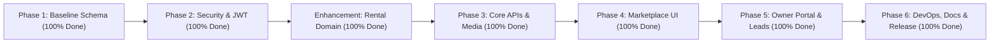

# HomeLens Requirements Traceability Matrix & Roadmap Report

## 1. Requirements Traceability Matrix (RTM)

This matrix maps every specific business requirement for HomeLens directly to the database columns, backend APIs, frontend components, and automated test cases that satisfy it.

| # | Requirement Category | Specific Business Need | Database Implementation | Backend API / Service | Frontend Component / View | Test Verification |
| :- | :--- | :--- | :--- | :--- | :--- | :--- |
| **1** | **Property Basic Information** | Title & Description | `properties.title`, `description` | `CreatePropertyRequest`, `PropertyResponse` | `OwnerDashboardPage`, `PropertyDetailPage` | `PropertyIntegrationTests` (step 2) |
| | | Complete Address & Location | `properties.address`, `city`, `state`, `postal_code` | `CreatePropertyRequest`, `PropertyResponse` | `PropertyCard`, `OwnerDashboardPage` | `PropertyIntegrationTests` (step 2) |
| | | Property Type (Gated Community / Individual House) | `properties.property_type` (`PropertyType` enum) | `PropertyController` query param, `PropertySpecification` | `PropertyFilters`, `PropertyCard`, `OwnerDashboardPage` | `PropertyIntegrationTests` (step 2) |
| | | BHK Configuration (`1 RK` to `4+ BHK`) | `properties.bhk_type` (`BhkType` enum/string) | `PropertyController` query param, `PropertySpecification` | `PropertyFilters`, `PropertyCard`, `OwnerDashboardPage` | `PropertyIntegrationTests` (step 3) |
| | | Monthly Rent (in INR ₹) | `properties.monthly_rent` (`NUMERIC(12,2)`) | `PropertyService.createProperty`, `PropertyResponse` | Formatted with `Intl.NumberFormat('en-IN')` in UI | `PropertyIntegrationTests` (step 2) |
| | | Availability Status (`AVAILABLE` / `RENTED`) | `properties.status` (`PropertyStatus` enum) | `PATCH /api/properties/{id}/status` | Status toggle button in `OwnerDashboardPage` | `PropertyIntegrationTests` (step 6) |
| **2** | **Occupancy Requirements** | Family occupancy allowed | `properties.family_allowed` (`BOOLEAN`) | `PropertySpecification.hasFamilyAllowed` | Checkbox toggle in `PropertyFilters`, tags in cards | `PropertyIntegrationTests` (step 2) |
| | | Single occupancy allowed | `properties.single_allowed` (`BOOLEAN`) | `PropertySpecification.hasSingleAllowed` | Checkbox toggle in `PropertyFilters`, tags in cards | `PropertyIntegrationTests` (step 2) |
| | | Support both simultaneously | Handled independently | Both flags can be `true` | Displayed as `Family & Single` tag in UI | `PropertyIntegrationTests` (step 2) |
| **3** | **Additional Charges** | Monthly electricity charges | `properties.electricity_charges` | `PropertyResponse.electricityCharges` | Breakdown card in `PropertyDetailPage` | `PropertyIntegrationTests` (step 2) |
| | | Monthly water charges | `properties.water_charges` | `PropertyResponse.waterCharges` | Breakdown card in `PropertyDetailPage` | `PropertyIntegrationTests` (step 2) |
| | | Clear distinction from base rent | Separate columns & getters | Calculated `getTotalMonthlyCharges()` | Transparent breakdown table & card | `PropertyIntegrationTests` (step 2, 5) |
| **4** | **Water Availability** | Continuous Water Supply (Yes / No) | `properties.water_availability` (`BOOLEAN`) | `PropertySpecification.hasWaterAvailability` | Filter checkbox in `PropertyFilters`, badge in cards | `PropertyIntegrationTests` (step 3) |
| **5** | **Nearby Facilities & Distances** | Distances in kilometres to Hospital, College, School, Metro, Bus stop | `distance_hospital_km`, `distance_college_km`, `distance_school_km`, `distance_metro_km`, `distance_bus_stop_km` (`DOUBLE PRECISION`) | `PropertyResponse`, `CreatePropertyRequest`, `UpdatePropertyRequest` | "Nearby Distances" grid card in `PropertyDetailPage` & form in `OwnerDashboardPage` | `PropertyIntegrationTests` (step 2, 4) |
| **6** | **Property Images** | Multiple images for single property | `property_images` (1-to-many relationship) | `Property.images`, `PropertyResponse.images` | Multi-image thumbnail carousel in `PropertyDetailPage` | `PropertyIntegrationTests` (step 7) |
| | | Upload multiple photographs | Filesystem storage in `uploads/properties/` | `POST /api/properties/{id}/images` | File uploader in `OwnerDashboardPage` | `PropertyIntegrationTests` (step 7) |
| | | Image management & removal | Metadata cascade deletion | `DELETE /api/properties/{id}/images/{imageId}` | Photo Manager drawer in `OwnerDashboardPage` | `PropertyIntegrationTests` (step 7) |
| **7** | **Property Management** | Register new property | Stored in `properties` linked to owner | `POST /api/properties` | "Register New Property" tab in `OwnerDashboardPage` | `PropertyIntegrationTests` (step 2) |
| | | View registered properties | Filtered by owner agent ID | `GET /api/properties/my` | "My Properties" table in `OwnerDashboardPage` | `PropertyIntegrationTests` (step 10) |
| | | Edit property information | Updates matching columns | `PUT /api/properties/{id}` | Edit Property Modal in `OwnerDashboardPage` | `PropertyIntegrationTests` (step 5) |
| | | Update rent & additional charges | Updates financial columns | `PUT /api/properties/{id}` | Edit Property Modal in `OwnerDashboardPage` | `PropertyIntegrationTests` (step 5) |
| | | Change status (`AVAILABLE`/`RENTED`) | Atomic status transition | `PATCH /api/properties/{id}/status` | Interactive toggle pill in `OwnerDashboardPage` | `PropertyIntegrationTests` (step 6) |
| | | Manage photographs | Photo gallery CRUD | Photo upload/delete endpoints | Photo Manager Drawer in `OwnerDashboardPage` | `PropertyIntegrationTests` (step 7) |
| **8** | **Property Search & Filtering** | Filter by BHK | Dynamic criteria predicate | `GET /api/properties?bhkType=...` | BHK filter pill selector | `PropertyIntegrationTests` (step 3) |
| | | Filter by Min/Max Rent | Between predicate on `monthly_rent` | `GET /api/properties?minRent=...&maxRent=...` | Monthly rent range slider | `PropertyIntegrationTests` (step 3) |
| | | Filter by Occupancy | Boolean conjunction | `GET /api/properties?familyAllowed=...` | Occupancy rule checkboxes | `PropertyIntegrationTests` (step 3) |
| | | Filter by Property Type | Enum predicate | `GET /api/properties?propertyType=...` | Property type switcher | `PropertyIntegrationTests` (step 3) |
| | | Filter by Water Availability | Boolean equality | `GET /api/properties?waterAvailability=...` | Water supply filter toggle | `PropertyIntegrationTests` (step 3) |
| | | Filter by Availability Status | Status filter | `GET /api/properties?status=AVAILABLE` | Default available search filter | `PropertyIntegrationTests` (step 3) |

---

## 2. Six-Phase Implementation Review

- **Phase 1 (Data Modeling & Baseline Schema):** Completed Flyway migrations `V1`, `V2`, JPA entity relationships, and repository persistence tests.
- **Phase 2 (Security & JWT Authentication Engine):** Completed stateless JWT architecture, BCrypt password hashing, RBAC, and `6/6` integration tests.
- **Requirements Enhancement (Indian Rental Marketplace):** Migration `V3` primed the database schema for BHK types, INR rent, separate charges, water availability, and facility distances in km.
- **Phase 3 (Property Core APIs & Local Media Storage):** Completed `PropertyController`, `InquiryController`, JPA specification filtering, and local filesystem media management (`uploads/properties/`).
- **Phase 4 (Frontend Marketplace Experience):** Built modern React catalog, interactive filter drawer, photo carousel, transparent charges breakdown, and lead capture form.
- **Phase 5 (Property Owner Portal & Inquiries):** Built "My Properties" table, Edit Modal, Photo Manager drawer, inquiry inbox, and lead status lifecycle (`NEW` -> `CONTACTED` -> `RESOLVED` -> `CLOSED`).
- **Phase 6 (DevOps, Documentation & Release):** Delivered complete C4/system architecture documentation, REST API specifications, ERD data dictionary, unified multi-container Docker Compose setup, Nginx SPA router, CI/CD GitHub Actions pipeline, and comprehensive README.
